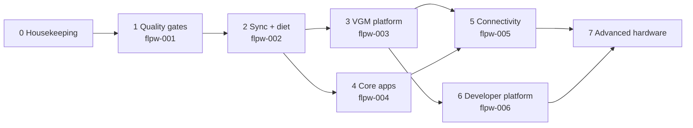

# Flipware roadmap

A plan for roughly the next twelve months of Flipware, written on 2026-11-26
after a read-through of this repository, its CI, its companion repositories
(the [VGM firmware fork](https://github.com/calvingunther66/video-game-module)
and the [FlipperEmu fork](https://github.com/calvingunther66/FlipperEmu)) and
a measured build of `dev` at `b6bf392`.

It is split into eight stages. Each stage ends in a release, has a goal and
exit criteria, and is broken into epics. Every stage has a tracking issue on
GitHub labelled `roadmap`, and every epic is a sub-issue of it, so work can be
picked up one issue (and one branch) at a time. Dates are targets, not
promises: a stage ends when its exit criteria are met.

- [Where Flipware stands today](#where-flipware-stands-today)
- [Principles](#principles)
- [Timeline](#timeline)
- [Stage 0: Housekeeping and honest claims](#stage-0-housekeeping-and-honest-claims)
- [Stage 1: Quality gates and the first release](#stage-1-quality-gates-and-the-first-release)
- [Stage 2: Upstream sync and the flash and RAM diet](#stage-2-upstream-sync-and-the-flash-and-ram-diet)
- [Stage 3: The Video Game Module platform](#stage-3-the-video-game-module-platform)
- [Stage 4: Core apps, made easier](#stage-4-core-apps-made-easier)
- [Stage 5: Connectivity: Wi-Fi devboard, USB and Bluetooth](#stage-5-connectivity-wi-fi-devboard-usb-and-bluetooth)
- [Stage 6: Developer platform and ecosystem](#stage-6-developer-platform-and-ecosystem)
- [Stage 7: Advanced hardware](#stage-7-advanced-hardware)
- [Always-on work](#always-on-work)
- [Testing and hardware](#testing-and-hardware)
- [Risks](#risks)
- [How to work an epic](#how-to-work-an-epic)
- [Appendix: measurements and sources](#appendix-measurements-and-sources)

## Where Flipware stands today

What Flipware has built since it forked from Momentum (73 commits in 18
merged PRs since 2026-09-16) is real and mostly careful work: the VGM
coprocessor link, host sign-in with device-bound passkeys, a performance and
memory pass, SD and power fixes, battery health, write targets for iButton
and RFID, Sub-GHz capture compare, Texkom keys, the hotel card identifier and
the NFC protocol-plugin split. What is missing is mostly around it:

| Area | Finding |
|---|---|
| Releases | None yet: no tags, no GitHub releases. `release.yml` needs an `INDEXER_URL` secret that isn't set, and `release.md`, `devbuild.py` and `webhook.py` still point at Momentum's servers, web updater and donation links. `CHANGELOG.md` is Momentum's unreleased changelog with no Flipware entries. |
| Flash | The firmware image is 879,316 bytes and ends **1.3 KiB** below the radio stack at `0x080D7000`. There is no free 4 KiB page left. LTO is commented out in `firmware.scons` ("desperately out of flash space"), the CI gap check is set to 0 (`build.yml:188`), and 29 Sub-GHz decoders are disabled in `protocol_items.c` to make room. |
| RAM | Apps on SD run from a ~192 KB heap. Opening Sub-GHz leaves about 4.7 KB free; the lazy-allocation fix (`ecf4ae2`) was reverted (`a266091`) because Read rebooted. |
| Security | While the PIN lock is on, `rpc_session_open` (`applications/services/rpc/rpc.c:388-392`) refuses USB and BLE sessions but not `RpcOwnerUart`, which the expansion service opens, and the desktop RPC unlock handler (`rpc_desktop.c`) then unlocks. Inherited from upstream; it needs physical access, but it's cheaper than a DFU reflash. Host sign-in v2 is marked "untested on hardware". |
| VGM | Flipper side: coprocessor frame type 6 with CRC32, heatshrink, GPIO and a reserved HID-inject task (`applications/services/coproc`). RP2040 side: the HDMI desktop, the USB display stream, composite CDC+HID, heatshrink and GPIO exist on `feature/idea-list` of the VGM fork (+5.7k lines), unmerged into its default branch and never released. No computer-side viewer exists for the USB display stream. |
| Tests | 31 on-device unit-test suites (~334 cases) and three host tests (`tests/host/*`, `subghz_compare_test.c`), none run in CI. The FlipperEmu fork already boots Momentum and Unleashed builds, models the VGM including Flipware's coproc (`scripts/vgm_check.py --coproc`), and catalogues 24 firmware bugs (FW-01 to FW-24). Flipware has fixed two of them (FW-07, FW-15). |
| CI | Builds f7 only (f18 is versioned but never compiled), lints, and runs CodeQL. The indexer, size, PR-comment and webhook steps are always skipped. No caching; a push to a PR branch builds twice. |
| Upstream | No merge from Momentum or Unleashed since 2026-06-01 (`33671b9`); Unleashed work has arrived as hand ports since. |
| Project files | `CONTRIBUTING.md` is one newline, `CODEOWNERS` lists Momentum's maintainers, `FUNDING.yml` points at a Momentum maintainer, there is no `SECURITY.md`, and the JS SDK is still published as `@next-flip/fz-sdk-mntm`. Most Flipware features have no documentation; `ExpansionModules.md` doesn't mention frame type 6. |
| Platform limits | One foreground app at a time (`loader.c:740`); `ble_light` is peripheral-only; USB runs one interface at a time; the SD card is on SPI shared with the display. |

## Principles

1. **Every stage ends in a release.** Releases are numbered `flpw-001`,
   `flpw-002` and so on, in the style of the `mntm-` and `unlshd-` releases
   Flipware descends from.
2. **Flash is spent, not assumed.** Until Stage 2 frees space, a change that
   grows the firmware image must free as much elsewhere or move code to the SD
   card. New features default to apps and plugins on SD.
3. **Emulator first, device second.** Every PR runs in FlipperEmu in CI; the
   PR template's "tested on a device" box stays, and the hardware matrix below
   says which device each stage needs.
4. **Stay compatible.** Keep Momentum's app API and `FW_ORIGIN_Momentum`, so
   apps built for Momentum keep running. Remove exported API symbols only at an
   API major bump agreed with upstream.
5. **Stay close to upstream.** Sync monthly, and send generic fixes upstream
   so the fork's diff shrinks rather than grows.
6. **Scope.** Flipware's own additions aim at usability, reliability and
   getting more out of hardware you own. The roadmap keeps the regional
   transmit limits as shipped defaults and doesn't plan jammers, flooding or
   denial-of-service tools, or features whose main purpose is defeating someone
   else's locks, cards or rolling codes. Inherited upstream features stay as
   they are.
7. **Small PRs.** One epic is one or more focused PRs, each with a
   changelog line, a size report and a test.

## Timeline

| Stage | Window (target) | Theme | Release | Tracking |
|---|---|---|---|---|
| 0 | Dec 2026 (3 weeks) | Housekeeping, security fix, honest claims | none (lands in flpw-001) | [#25](https://github.com/calvingunther66/Flipware/issues/25) |
| 1 | Dec 2026 – Jan 2027 | CI gates, emulator tests, bug burndown | **flpw-001** | [#26](https://github.com/calvingunther66/Flipware/issues/26) |
| 2 | Feb – Mar 2027 | Upstream sync, flash and RAM headroom | flpw-002 | [#27](https://github.com/calvingunther66/Flipware/issues/27) |
| 3 | Apr – Jun 2027 | VGM desktop, display stream, coproc v2 | flpw-003 + VGM firmware 1.0 | [#28](https://github.com/calvingunther66/Flipware/issues/28) |
| 4 | Jun – Aug 2027 | Sub-GHz, NFC, RFID, IR, files, battery | flpw-004 | [#29](https://github.com/calvingunther66/Flipware/issues/29) |
| 5 | Aug – Oct 2027 | Wi-Fi updates, composite USB, BLE | flpw-005 | [#30](https://github.com/calvingunther66/Flipware/issues/30) |
| 6 | Oct – Dec 2027 | JS SDK, app kit, docs, upstreaming, tests | flpw-006 | [#31](https://github.com/calvingunther66/Flipware/issues/31) |
| 7 | 2028, as gates open | PKA, FIDO2, full BLE stack, background apps | as ready | [#32](https://github.com/calvingunther66/Flipware/issues/32) |

Stages 3 and 4 can overlap once Stage 2 has freed flash: Stage 3 is mostly
RP2040 and protocol work, Stage 4 mostly app work.

Priorities used below: **Must** (the stage doesn't ship without it),
**Should** (planned, can slip one stage), **Could** (only if time allows).

---

## Stage 0: Housekeeping and honest claims

Tracking issue: [#25](https://github.com/calvingunther66/Flipware/issues/25)

*December 2026, about three weeks.* Close the one security gap found, make
the public claims match the code, and replace what Flipware inherited but
doesn't use. Nothing here needs new hardware.

### 0.1 Close the expansion port while the PIN lock is on · Must

Issue: [#33](https://github.com/calvingunther66/Flipware/issues/33)

- Refuse `RpcOwnerUart` sessions while `FuriHalRtcFlagLock` is set, unless a
  new setting allows it (next to `allow_locked_rpc_usb` and
  `allow_locked_rpc_ble` in `lib/momentum/settings.h`).
- Decide what a locked device still gives a module. Recommended: screen
  mirroring only, so the VGM can show the lock screen, but no input, storage,
  app or desktop commands.
- Refuse `DesktopUnlockRequest` from a session that wasn't allowed while
  locked, whatever its owner.
- Audit the other ways out of the lock: RPC over BLE when allowed, the locked
  CLI shell (`cli_vcp.c`), and app launches from RPC.
- Add the expansion port to the threat model in `documentation/HostAuth.md`.

**Done when** a module on pins 13/14 can't open an RPC session or unlock a
PIN-locked Flipper by default, and an emulator check (`./flipperemu expansion
--rpc` while locked) proves it.
**Start at** `applications/services/rpc/rpc.c`, `rpc_desktop.c`,
`applications/services/expansion/expansion_worker.c`.

### 0.2 Make the public claims match the code · Must

Issue: [#34](https://github.com/calvingunther66/Flipware/issues/34)

- In `ReadMe.md` and `website/public/index.html`, say that the HDMI desktop
  and the USB display stream run on Flipware's VGM firmware, which is in
  preview until Stage 3, and link to it.
- Until `flpw-001` exists, tell people to build from source instead of
  pointing them at an empty releases page.
- Align the link-speed wording: Flipware's VGM firmware asks for 2,000,000
  baud, the stock module for 1,843,200 (`coproc.h` says "~1.8 Mbaud").
- Rename the stale "Momentum >" menu paths in `SubGHzSettings.md`,
  `SubGHzBypass&Extend.md`, `CustomFlipperName.md` and `AssetPacks.md`; the
  settings app is called Flipware now.

**Done when** every feature the ReadMe and website name is either in a
released build or clearly labelled as a preview with a link.

### 0.3 Project files · Must

Issue: [#35](https://github.com/calvingunther66/Flipware/issues/35)

- Write `CONTRIBUTING.md`: how to build, the PR template, API bump rules
  (`api_symbols.csv` for f7 and f18), changelog lines, the size report, how
  AI-assisted PRs are reviewed, and how upstream authors are credited.
- Replace `CODEOWNERS` and `FUNDING.yml` (both point at Momentum's team).
- Fix the "unleashed firmware" wording in the bug template.
- Add `SECURITY.md` with private reporting for the PIN lock, host sign-in and
  U2F, and turn on GitHub private vulnerability reporting.
- Add "checked in FlipperEmu" and "size report reviewed" boxes to the PR
  template.

### 0.4 A Flipware changelog · Must

Issue: [#36](https://github.com/calvingunther66/Flipware/issues/36)

- Move Momentum's unreleased changelog to
  `documentation/upstream/MomentumChangelog.md`.
- Start a Flipware `CHANGELOG.md`, backfilled from the 18 merged PRs (#1 to
  #23), under
  Added / Updated / Fixed, noting the base (Momentum `dev` at `33671b9` plus
  Unleashed ports).
- `release.py` should read the Flipware changelog section for the tag being
  released.

### 0.5 CI cleanup · Must

Issue: [#37](https://github.com/calvingunther66/Flipware/issues/37)

- Remove the indexer upload, DFU size, PR comment and devbuild webhook steps:
  they always skip, and they would call Momentum's servers if the secret were
  ever set. Delete or rewrite `webhook.py` and `devbuild.py`, and clean
  `pr-cleanup.yml`.
- Build once per change: share one concurrency group between push and PR
  runs. Cache the toolchain and compiler output.
- Pin actions to commit SHAs, add Dependabot for actions, and drop write
  permissions the Build job no longer needs.
- Build f18 in CI (its API table is bumped by hand but never compiled), or
  stop versioning it. Recommended: build it, since it's cheap.
- Quiet the false "Symbols not resolved using firmware's API" warnings for the
  NFC protocol plugins. They resolve through `nfc_app_api_table`, so a real
  unresolved symbol currently hides among them.

**Stage 0 exit:** the lock fix is merged with a test; ReadMe, website and
docs are accurate; CI has no dead steps or Momentum endpoints; a Flipware
changelog exists.

---

## Stage 1: Quality gates and the first release

Tracking issue: [#26](https://github.com/calvingunther66/Flipware/issues/26)

*December 2026 to January 2027, about seven weeks. Ships `flpw-001`.* Build
the safety net (size gate, host tests, emulator tests), burn down known bugs,
and publish the first release.

### 1.1 A working release pipeline · Must

Issue: [#38](https://github.com/calvingunther66/Flipware/issues/38)

- On a `flpw-*` tag, attach to a GitHub release: the update `.tgz` for
  qFlipper, the SD update `.zip`, `firmware.dfu`, the SDK zip and
  `SHA256SUMS`.
- Write release notes from the tag's changelog section, using a
  `release.md` template with Flipware links only.
- Mark `-rc` tags as pre-releases. Optionally run a nightly pre-release from
  `dev`.
- Decide what to do about the `.momentum_firstboot.flag` path (keep it for
  compatibility, or migrate it), and refresh `documentation/OTA.md`.

**Done when** pushing a tag produces a complete release with no manual steps.

### 1.2 A flash and RAM report on every PR · Must

Issue: [#39](https://github.com/calvingunther66/Flipware/issues/39)

- Add a script that reads `firmware.elf` and the radio address from
  `update.fuf` and reports:
  - section sizes;
  - the image size;
  - free bytes and free 4 KiB pages below the radio stack;
  - `.data` and `.bss`;
  - the change against the latest `dev` build;
  - the symbols that grew the most.
- Post the report as a PR comment and a job summary.
- Fail the build when free flash drops below a threshold. The threshold
  starts at today's value and rises as Stage 2 frees space. Also fail when a
  PR grows the image by more than 512 bytes without a `flash-budget` label.
- Replace the `min_gap=0` check in `build.yml`.

The baseline is an 879,316-byte image with 1.3 KiB to the radio stack.

### 1.3 Host tests in CI · Must

Issue: [#40](https://github.com/calvingunther66/Flipware/issues/40)

- Add a job that checks out `lib/mbedtls` and runs
  `tests/host/host_auth/run.sh`, `tests/host/lfrfid_manual_format/run.sh` and
  `applications/main/subghz/helpers/tests/subghz_compare_test.c`.
- Generalise the small furi shim in `tests/host/lfrfid_manual_format/shim`
  into `tests/host/shim`, so protocol and parser code can be tested without
  hardware. Add an `fbt` target that runs all host tests.

### 1.4 Emulator tests in CI · Must

Issue: [#41](https://github.com/calvingunther66/Flipware/issues/41)

- Build the FlipperEmu fork (QEMU-based) once into a cached container image,
  pinned to a commit.
- Run its checks against every PR's firmware:
  - `smoke_test.py` (boot, SD, input, radios);
  - `update_check.py` (an update package installs);
  - `vgm_check.py --coproc` (Flipware's coprocessor);
  - `ble_check.py` (pairing and RPC over BLE);
  - `uart_check.py`.
  Keep the job under 15 minutes.
- Keep screenshots and recordings as artifacts when a check fails.
- Stretch: build the `unit_tests` app set and run the 31 on-device suites in
  the emulator with `scripts/testops.py run_units`.

**Done when** a PR that breaks boot, updates, the coproc link or BLE pairing
goes red.

### 1.5 Bug burndown · Must

Issue: [#42](https://github.com/calvingunther66/Flipware/issues/42)

Triage FlipperEmu's bug list against Flipware. Fix what reproduces, and add a
regression check for each fix.

- **Reported on Momentum or on all firmwares (most likely to affect Flipware):**
  - FW-01: an RPC storage list with no path; `rpc_storage.c:267` calls
    `strcmp` on it.
  - FW-02 and FW-04: NFC shell `dump` and `scanner` hangs and crashes.
  - FW-06: closing the NFC app while it works.
  - FW-08: the desktop drawing its slideshow too early after an update.
  - FW-14: USB-UART bridge on channel 1.
  - FW-19: NFC shell `emulate -f` of a Type 4 tag.
  - FW-21: the ISO14443A listener after ISO15693 emulation.
  - FW-23: a thread flag lost during `furi_thread_flags_clear`.
  - FW-24: mass storage answers (owned by 5.4).
- **Seen on official firmware, to verify:** FW-03, FW-09, FW-10 to FW-13,
  FW-16 to FW-18, FW-20.
- **Already fixed:** FW-07 (`26bdd91`) and FW-15 (`8e7b990`).
- **From the code:**
  - the loader double-start race (`loader.c:124`);
  - files left open on SD unmount (`storage_ext.c:179`);
  - the ignored SPI timeout (`furi_hal_spi.c:81`);
  - a failed battery-gauge read shown as "0 cycles" (`BQ27220_ERROR` is 0).

**Done when** every item is marked fixed, not applicable, or deferred with a
reason.

### 1.6 Host sign-in on real hardware · Must

Issue: [#43](https://github.com/calvingunther66/Flipware/issues/43)

- Run the hardware checklist at the end of `documentation/HostAuth.md` with
  the Mac tool (Secure Enclave) and the Windows/Linux tool (python-fido2).
- Fix what fails, then remove the "untested" notes from the docs and both
  tools.
- Decide whether host sign-in ships in `flpw-001` enabled, opt-in or hidden.

### 1.7 Ship flpw-001 · Must

Issue: [#44](https://github.com/calvingunther66/Flipware/issues/44)

- Freeze features and tag `flpw-001-rc1`.
- Run a device pass covering:
  - Sub-GHz read and send;
  - NFC read and emulate;
  - LF RFID, iButton and IR;
  - Bad KB over USB and BLE;
  - BLE pairing with the phone app;
  - installing from Momentum and from the official firmware;
  - SD apps;
  - VGM screen mirroring.
- Write install docs (qFlipper, SD zip, moving over from Momentum) and add a
  download link to the website.

**Stage 1 exit:** `flpw-001` is on the releases page and installs cleanly
from Momentum and from the official firmware; every PR gets a size report,
host tests and emulator checks.

---

## Stage 2: Upstream sync and the flash and RAM diet

Tracking issue: [#27](https://github.com/calvingunther66/Flipware/issues/27)

*February to March 2027, about eight weeks. Ships `flpw-002`.* Catch up with
six months of upstream work, then make room. Almost everything after this
stage needs flash or RAM that doesn't exist today.

### 2.1 Upstream sync playbook and first sync · Must

Issue: [#45](https://github.com/calvingunther66/Flipware/issues/45)

- Add remotes for Momentum (`Next-Flip/Momentum-Firmware` `dev`), Unleashed
  and the official firmware. Write `documentation/UpstreamSync.md` covering:
  - **Order:** merge Momentum `dev` into a sync branch; take Unleashed work
    through Momentum where it has already landed there.
  - **Hot files:**
    - `targets/*/api_symbols.csv`;
    - `assets/packs`;
    - `applications/main/nfc`, after the protocol-scene move;
    - the lfrfid, subghz and ibutton libraries and apps;
    - `furi_hal_nfc*`, `furi_hal_sd.c` and `furi_hal_power.c`;
    - `loader.c`, `gui.c`, `view_dispatcher.c` and `cli_vcp.c`;
    - `elf_file.c` and the updater flasher.
  - **API table conflicts:** take upstream's table, re-add Flipware's symbols,
    bump the minor version.
  - **Gates:** the sync must pass 1.2 to 1.4.
- Merge current Momentum `dev` and bump the `applications/external`
  submodule. Point it at Flipware's own Momentum-Apps fork if Flipware starts
  patching apps.

### 2.2 Find the bytes · Must

Issue: [#46](https://github.com/calvingunther66/Flipware/issues/46)

- Turn on the linker map and extend the 1.2 report to attribute flash by
  directory and library. A first estimate, grouped by symbol name:

  | Area | Flash |
  |---|---|
  | NFC | ~108 KiB |
  | Sub-GHz library | ~103 KiB |
  | libc and math | ~97 KiB |
  | HAL | ~61 KiB |
  | GUI | ~44 KiB |
  | LF RFID | ~34 KiB |
  | mJS | ~31 KiB |
  | FatFs | ~30 KiB |
  | firmware API table | 25 KiB |
- Try LTO again (it's commented out in `firmware.scons`), keeping every
  exported API symbol. Measure it, boot it in the emulator and on a device,
  and check ISRs and weak symbols. This may be the largest single win.
- Find what pulls in `_strtod_l`, `powf` and float `printf`, and replace them
  with integer code where that's cheap.
- Build debug-only CLI test commands (`storage heatshrink`, `storage crc32`)
  only in `DEBUG` builds.

### 2.3 Sub-GHz decoders as SD plugins · Should

Issue: [#47](https://github.com/calvingunther66/Flipware/issues/47)

- Start with a design spike:
  - Keep the protocol registry API in firmware, along with every protocol
    whose functions appear in `api_symbols.csv` (used by Add Manually,
    ProtoPirate and other apps).
  - Move the other decoders and encoders into `.fal` plugins that the Sub-GHz
    app loads through a composite API resolver, as NFC does
    (`nfc_protocol_support.c`).
  - Load plugins by modulation and frequency, and unload them afterwards to
    protect RAM.
- Bring back the 29 disabled decoders (`protocol_items.c:43-73`) as receive-only
  plugins: 25 weather stations, Schrader TPMS, the POCSAG pager, X10 and
  BiSecur.

### 2.4 Smaller flash wins · Could

Issue: [#48](https://github.com/calvingunther66/Flipware/issues/48)

- Move mJS into the JS app (77 exported functions) at the next API major
  bump agreed with Momentum.
- Remove duplicate built-in fonts. Move rarely used built-in icons and
  animations to SD asset packs.

### 2.5 RAM headroom · Must

Issue: [#49](https://github.com/calvingunther66/Flipware/issues/49)

- Re-land the Sub-GHz lazy receive-buffer allocation (`ecf4ae2`, reverted in
  `a266091`): reproduce the reboot in the emulator, find the cause, fix it.
- Measure the largest free block after typical flows, keep big buffers out of
  long-lived services, and extend the low-memory launch checks from `3737931`.
- Target: 10 KiB or more free in Sub-GHz Read with qFlipper connected, and a
  50-signal capture without an out-of-memory reboot. The changelog quotes
  about 50 signals normally and about 10 with qFlipper.

**Stage 2 exit:** the first upstream sync is merged, there are at least 48 KiB
(12 pages) of free flash after it, the RAM targets are met, and `flpw-002` is
released.

---

## Stage 3: The Video Game Module platform

Tracking issue: [#28](https://github.com/calvingunther66/Flipware/issues/28)

*April to June 2027, about ten weeks. Ships `flpw-003` and Flipware VGM
firmware 1.0.* This turns the VGM from a screen mirror into Flipware's
signature feature: a desktop on HDMI and over USB, and a coprocessor and
bus expander that apps can use.

### 3.1 A home and a release for the VGM firmware · Must

Issue: [#50](https://github.com/calvingunther66/Flipware/issues/50)

- In the VGM fork, merge `feature/coproc-offload` and `feature/idea-list` into
  a `flipware` branch and make it the default. Its `dev` is still upstream's.
  `feature/idea-list` holds the desktop shell, the USB display stream,
  composite CDC+HID, heatshrink, the GPIO expander and battery in the top bar.
- Add CI that builds the `.uf2` (CMake with the ARM toolchain; CMake 4 needs
  `CMAKE_POLICY_VERSION_MINIMUM=3.5`), and tag releases.
- Ship the matching `.uf2` with each Flipware release so the Video Game Module
  Tool can install it. The Flipper warns when the VGM firmware is older than
  the protocol it needs (from 3.2).
- Check the upstream VGM firmware's license and credit it.

### 3.2 Coprocessor protocol v2 · Must

Issue: [#51](https://github.com/calvingunther66/Flipware/issues/51)

- **A hello exchange:** firmware version, protocol version, a bitmap of
  supported tasks, the largest payload and the baud rate. With it,
  `coproc_supports()` can tell the truth (`coproc.h:42-44` says yes to
  everything today).
- **Messages from module to Flipper**, which `expansion_worker.c:514` drops
  today: GPIO edges, IMU data-ready, keyboard and mouse from the desktop, and
  job progress.
- **Don't block:** move job transfers off the expansion control thread
  (`expansion.c:476`), allow a small window of chunks in flight instead of one,
  and cap the size of outbound jobs.
- **Clean-up:**
  - the `FuriApiLock` leaked on every timeout (`coproc.c:231-239`);
  - `expansion_set_coproc_callback` is public and single-slot: make it private
    or multi-owner;
  - the stale comment at `expansion.h:126` and the unused thread field at
    `coproc_i.h:10`.
- **Docs and tests:** document frame type 6 in
  `documentation/ExpansionModules.md`. Add a `coproc` unit-test suite, and
  keep `vgm_check.py --coproc` in CI.

### 3.3 The VGM as a bus expander · Should

Issue: [#52](https://github.com/calvingunther66/Flipware/issues/52)

The VGM takes over the Flipper's GPIO header, so give its own 11 breakout
pins (GPIO 16, 17 and 21-29, with ADC on 26-29) what the header could do:

- batched GPIO (the record format already allows it);
- PWM, I2C, SPI and a UART bridge, using RP2040 PIO where it helps;
- edge events (needs 3.2).

Expose these through the `vgm` CLI, the JS `vgm` module and its typings, and
a VGM screen in the GPIO app.

### 3.4 VGM desktop 1.0 · Must

Issue: [#53](https://github.com/calvingunther66/Flipware/issues/53)

**On the RP2040** (`app/desktop/*`):
- Page through folders larger than `DT_MAX_FILES` (48 entries).
- Open a file in the app it belongs to (RPC app start with the file), and
  rename or delete with a confirmation.
- Make the dock configurable; it's six hard-coded apps today.
- Add a settings screen, and follow Flipware's VGM colours.

**On the Flipper:** add whatever RPC lacks for the desktop, defined in 3.2:
- battery, clock and SD status;
- typing into the Flipper's text inputs;
- mouse mapping.

While the Flipper is locked, the desktop shows the mirror only (see 0.1).
FlipperEmu already renders the HDMI picture, so add golden-image checks for
the main screens.

### 3.5 A USB display viewer for computers · Must

Issue: [#54](https://github.com/calvingunther66/Flipware/issues/54)

The VGM streams its 320x240 desktop over a second CDC interface:
- From the device: HELLO, row-diffed RLE ROW messages and FRAME.
- From the computer: REFRESH, KEY, CLICK and WHEEL.

No viewer exists for it; `tools/desktop_preview` only renders frames
offline. Build:

- a WebSerial viewer on flipware-fw.dev, which needs no install (Chrome and
  Edge);
- `scripts/vgm_display.py` for Linux, macOS and Windows;
- protocol documentation in `documentation/`.

### 3.6 Keyboard, mouse and motion through the VGM · Should

Issue: [#55](https://github.com/calvingunther66/Flipware/issues/55)

- Wire up `CoprocTaskHidInject` (task 3; the VGM side exists, nothing on the
  Flipper uses it). Then Bad KB and the USB remote can type and point through
  the VGM's USB-C while the Flipper's own USB stays on qFlipper or the CLI.
- Use the VGM's ICM-42688-P IMU, already readable from JS, for an air-mouse
  mode and an optional tilt navigation.

### 3.7 Offload jobs that earn their place · Could

Issue: [#56](https://github.com/calvingunther66/Flipware/issues/56)

- Add a `coproc bench` command that times each task locally and offloaded,
  and publish the table. `coproc.h` already notes CRC32 is no faster.
- Candidates:
  - SHA-256 for update and file checks;
  - heatshrink for transfers;
  - rendering for the desktop: Sub-GHz RAW waveforms, image thumbnails;
  - parsing JSON from FlipperHTTP (Stage 5).
- Keep only the jobs that win.

**Stage 3 exit:** what the ReadMe says about the VGM is true on released
firmware; a computer can show and drive the VGM desktop; coproc v2 is
documented and tested in the emulator and on a VGM.

---

## Stage 4: Core apps, made easier

Tracking issue: [#29](https://github.com/calvingunther66/Flipware/issues/29)

*June to August 2027, about ten weeks. Ships `flpw-004`.* Workflow
improvements every user notices, built mostly as SD apps and plugins so they
stay within the flash budget.

### 4.1 Sub-GHz · Must

Issue: [#57](https://github.com/calvingunther66/Flipware/issues/57)

- Compare RAW captures. `subghz_compare` handles decoded keys up to 512 bits;
  BinRAW compares only its first block.
- Add a spectrum and waterfall view to the frequency analyzer from CC1101 RSSI
  sweeps, shown larger on the VGM.
- Show the weather station, TPMS and pager decoders from 2.3 in a sensors view
  in Read.
- Keep history across sessions, export it, and handle "memory full" more
  clearly.

### 4.2 NFC · Should

Issue: [#58](https://github.com/calvingunther66/Flipware/issues/58)

- Texkom: add TK15 to Add Manually, and writing where blanks allow.
- Compare two `.nfc` dumps block by block, like Sub-GHz compare.
- NDEF sharing: emulate a tag that carries your own URL, text or Wi-Fi record
  for phones to read, with an NDEF editor.
- Fix protocol gaps:
  - ISO14443-4 block chaining (`iso14443_4_layer.c:292,323,345`);
  - the ISO15693 mask (`iso15693_3_listener_i.c:81`);
  - the empty ISO14443-B listener in the HAL (`furi_hal_nfc_iso14443b.c:107`).
- More read-only card identifiers: the hotel plugin knows three signatures.

### 4.3 LF RFID and iButton · Should

Issue: [#59](https://github.com/calvingunther66/Flipware/issues/59)

- Port Unleashed's Hitag write targets and per-chip verification on top of
  Flipware's write-target settings.
- Add a T5577 configuration screen for your own tags, including recovering a
  blank whose password you know.
- Handle iButton write errors properly (`rw1990.c:67`, `tm2004.c:26`,
  `ibutton_worker_modes.c:182`).

### 4.4 Infrared · Should

Issue: [#60](https://github.com/calvingunther66/Flipware/issues/60)

- Add JVC, Sharp and Denon decoders (these signals are saved as raw today).
- Refresh the universal remote libraries (`scripts/fix_ir_universals.py`) and
  add air-conditioner presets.
- Add macros: a sequence of saved buttons with delays between them.

### 4.5 Files and navigation · Should

Issue: [#61](https://github.com/calvingunther66/Flipware/issues/61)

- Archive: search, sort by name, date or size, select several files to move
  or delete, and a recent-files list.
- One consistent "open with" from any file to the app that handles it.

### 4.6 Battery and power care · Should

Issue: [#62](https://github.com/calvingunther66/Flipware/issues/62)

- Add a charge-limit setting in Power settings. The driver and HAL already
  support a charge voltage limit (`bq25896_set_vreg_voltage`,
  `furi_hal_power_get_battery_charge_voltage_limit`). Offer presets, for
  example full (4.208 V) and battery-saver (4.1 V) for a Flipper that lives on
  a desk.
- Log battery health, cycles and temperature to the SD card, and show the
  trend in Battery Info.
- Show failed gauge reads as unknown instead of 0.
- Fix FW-18 (the CPU never sleeps while a CLI command waits) and measure
  standby current.

### 4.7 Accessibility and input · Could

Issue: [#63](https://github.com/calvingunther66/Flipware/issues/63)

- Remappable keys and long-press timing (`input_settings_app`).
- A left-handed (rotated) mode.
- Larger text on key screens (GUI scaling is a TODO today).
- Consistent haptic and LED feedback.

**Stage 4 exit:** each epic has user docs, an emulator check, and a device
check, and `flpw-004` is released.

---

## Stage 5: Connectivity: Wi-Fi devboard, USB and Bluetooth

Tracking issue: [#30](https://github.com/calvingunther66/Flipware/issues/30)

*August to October 2027, about ten weeks. Ships `flpw-005`.* Updates without
a computer, USB that does two things at once, and steadier Bluetooth.

### 5.1 Updates and time over Wi-Fi · Must

Issue: [#64](https://github.com/calvingunther66/Flipware/issues/64)

- With the Wi-Fi devboard running FlipperHTTP (ESP Flasher already ships it):
  - look up the latest `flpw-*` release;
  - download its update package to SD, with resume;
  - check it against `SHA256SUMS` from 1.1;
  - hand it to the updater.
- Set the RTC from NTP.
- Keep Wi-Fi credentials out of logs and encrypt them with a secure-enclave
  key.

### 5.2 The devboard as an expansion module · Could

Issue: [#65](https://github.com/calvingunther66/Flipware/issues/65)

Teach an ESP32-S2 firmware the expansion protocol and the coproc v2 hello. The
offload jobs (3.7) and bus bridges (3.3) then work with either module, and
apps find out what's attached instead of assuming a VGM.

### 5.3 Composite USB · Should

Issue: [#66](https://github.com/calvingunther66/Flipware/issues/66)

- `furi_hal_usb_set_config` runs one interface at a time, so the CLI and RPC
  drop whenever HID or U2F is active. Add CDC+HID and CDC+mass-storage
  configurations within the USB full-speed endpoint budget, so qFlipper stays
  connected during Bad KB, the USB remote and U2F.
- Fix FW-14 (USB-UART bridge on channel 1).

### 5.4 The SD card as a USB drive · Should

Issue: [#67](https://github.com/calvingunther66/Flipware/issues/67)

- Add a mass-storage mode for the SD card itself: unmount it from the
  firmware and expose it over USB.
- Fix FW-24 (READ FORMAT CAPACITIES off by one block, PREVENT ALLOW MEDIUM
  REMOVAL read from the wrong byte).
- Fix the MTP and CLI-bridge app manifests that fbt rejects (`.f0_mtp`,
  `.cli_gui`), so those apps are built at all.

### 5.5 Bluetooth reliability · Should

Issue: [#68](https://github.com/calvingunther66/Flipware/issues/68)

- Fix FW-17: the BLE serial RPC status sends three stack bytes.
- Harden pairing and bonding, and check phone-app compatibility with
  FlipperEmu's `ble_check.py` in CI.
- Polish the BLE remote and Bad KB over BLE. Stay within `ble_light` (a
  peripheral-only stack) until 7.3.

### 5.6 Flipware Desktop in the browser · Could

Issue: [#69](https://github.com/calvingunther66/Flipware/issues/69)

Extend the 3.5 viewer to speak protobuf RPC to the Flipper's own USB port: a
screen mirror (`rpc_gui.c`), a file manager (`rpc_storage.c`) and an app
launcher (`rpc_app.c`). That gives the VGM desktop experience without a VGM.

**Stage 5 exit:** a Flipper with a Wi-Fi devboard updates itself to the next
release; the CLI survives HID use; `flpw-005` is released.

---

## Stage 6: Developer platform and ecosystem

Tracking issue: [#31](https://github.com/calvingunther66/Flipware/issues/31)

*October to December 2027, about eight weeks. Ships `flpw-006`.* Make
Flipware easy to build on, and shrink the fork's diff.

### 6.1 A Flipware JS SDK · Must

Issue: [#70](https://github.com/calvingunther66/Flipware/issues/70)

The SDK in `applications/system/js_app/packages/fz-sdk` is still published as
`@next-flip/fz-sdk-mntm` 1.0.1, but it carries Flipware's `vgm` typings.

- Publish it, and the app creator, under a Flipware name, from CI on tags.
- Update `documentation/js`, which links to Next-Flip.

### 6.2 More JS modules · Should

Issue: [#71](https://github.com/calvingunther66/Flipware/issues/71)

The JS app has badusb, blebeacon, event_loop, flipper, gpio, gui, i2c,
infrared (send only), math, notification, serial, spi, storage, subghz,
usbdisk and vgm. Add:

- the coproc v2 bus bridges and events (3.3);
- battery and power readings;
- the RTC;
- speaker tones;
- IR receive;
- USB mouse and media keys;
- read-only NFC (UID and NDEF).

Give each new module a feature flag (`js_modules.c` lists only `vgm` today).

### 6.3 An app developer kit · Should

Issue: [#72](https://github.com/calvingunther66/Flipware/issues/72)

A template repository with:
- a ufbt app;
- a GitHub Action that builds it against the Flipware SDK artifact;
- emulator runs of the app (`./flipperemu ufbt launch` and `app_check.py`).

App authors get CI without owning hardware.

### 6.4 A docs site · Should

Issue: [#73](https://github.com/calvingunther66/Flipware/issues/73)

- Build the Doxygen docs (configured, never built), the feature docs and the
  JS docs into flipware-fw.dev in CI, and deploy the website automatically when
  `website/` changes.
- By the end of this epic, every Flipware feature has a page:
  - coproc and VGM;
  - host sign-in;
  - battery health;
  - write targets;
  - Sub-GHz compare;
  - Texkom;
  - Seed Capturer;
  - the hotel identifier;
  - RFID facility-code entry.

### 6.5 Bundled apps · Could

Issue: [#74](https://github.com/calvingunther66/Flipware/issues/74)

- Decide which Momentum-Apps ship.
- Keep the external apps building cleanly.
- Check each bundled app's compatibility in the emulator on every submodule
  bump.

### 6.6 Send generic fixes upstream · Should

Issue: [#75](https://github.com/calvingunther66/Flipware/issues/75)

Offer Momentum and the official firmware the fixes that aren't Flipware-specific:
- the performance pass (PR #12);
- the SD fixes;
- the FW-xx fixes from 1.5;
- the code-scanning fixes (PR #16);
- DMA receive on the expansion port.

Every one accepted is one less conflict in future syncs.

### 6.7 Test coverage · Should

Issue: [#76](https://github.com/calvingunther66/Flipware/issues/76)

Add unit suites for areas with none:
- iButton and 1-Wire;
- the loader;
- the Bad KB script parser;
- the desktop lock;
- Momentum settings.

Then fill the gaps in existing areas:
- LF RFID: 20 of its 26 protocols are untested;
- Sub-GHz: 13 decoders have no test vectors, for example Jarolift, Ditec
  GOL4, KeyFinder2 and Beninca ARC.

Run the whole suite in the emulator in CI (the 1.4 stretch goal, made
standard).

**Stage 6 exit:** the SDK is published under Flipware's name, a third-party
app can get CI with emulator runs from the template, docs are online, and
`flpw-006` is released.

---

## Stage 7: Advanced hardware

Tracking issue: [#32](https://github.com/calvingunther66/Flipware/issues/32)

*2028, each epic starting when its gate opens.* Research-sized work that gets
more out of the STM32WB55 and the modules.

### 7.1 Hardware public-key crypto · Could

Issue: [#77](https://github.com/calvingunther66/Flipware/issues/77)

- The STM32WB55's PKA is switched on only for Bluetooth (`furi_hal_bt.c:47`).
  U2F (`u2f.c:148`) and host sign-in sign and verify in software with mbedtls.
- Use the PKA for P-256, coordinating with the radio core through its
  hardware semaphore. That makes these faster, and may let the software
  elliptic-curve code leave flash.

### 7.2 A FIDO2 security key · Could

Issue: [#78](https://github.com/calvingunther66/Flipware/issues/78)

U2F is CTAP1 only. Add CTAP2 (passkeys with resident credentials) as an SD
app:
- CBOR encoding;
- credentials stored under secure-enclave AES keys;
- user presence on OK, and a PIN entered on the Flipper.

It reuses what host sign-in taught about WebAuthn, and needs composite USB
(5.3) so the CLI can coexist.

### 7.3 Full Bluetooth stack · Could

Issue: [#79](https://github.com/calvingunther66/Flipware/issues/79)

*Gate: about 64 KiB more free flash than the light stack needs.*

`ble_full` adds the central and observer roles and RF test mode. That enables:
- a BLE scanner;
- detecting an unknown tracker that travels with you (AirTag, SmartTag,
  Tile);
- a GATT client for BLE sensors.

The cost is a bigger radio stack in shared flash; the light stack is 114 KiB.

### 7.4 Background apps · Could

Issue: [#80](https://github.com/calvingunther66/Flipware/issues/80)

Only one app runs at a time (`loader.c:740`); background work exists only as
startup hooks such as FindMy's. Generalise that into background apps with RAM
limits, for example the BLE remote, the UART bridge, beacons and data loggers.

### 7.5 Large-screen apps on HDMI · Could

Issue: [#81](https://github.com/calvingunther66/Flipware/issues/81)

Let apps draw a 320x240 second screen on the VGM desktop from draw lists sent
over coproc v2. Examples: a Sub-GHz waterfall, an NFC hex view, logic-analyzer
traces.

---

## Always-on work

- **Upstream sync** every month, following the playbook from 2.1.
- **Flash budget review** at every release; raise the 1.2 threshold as space
  is freed.
- **Security:** triage CodeQL alerts and `SECURITY.md` reports; every change
  to the lock, host sign-in, U2F or the expansion port gets an emulator check.
- **Regression checks:** every bug fix ships with a host, emulator or unit
  test.
- **Docs and changelog** in the same PR as the change.

## Testing and hardware

| Hardware | Available | Used for |
|---|---|---|
| Flipper Zero | yes | every stage |
| Video Game Module | yes | 0.1, 3.x, 5.2, 7.5 |
| Wi-Fi devboard / ESP32 | yes | 5.1, 5.2 |
| External CC1101, NRF24, other GPIO modules | no | emulator only (FlipperEmu models the header's UART, I2C and SPI), or community testers |
| Computers | macOS, Windows, Linux | host sign-in tools (1.6), USB display viewer (3.5), composite USB (5.3) |

## Risks

| Risk | Effect | Mitigation |
|---|---|---|
| Flash stays full | Stages 3 to 7 stall | Stage 2 comes before features; size gate from 1.2; features default to SD |
| Upstream drift | Each sync gets harder | Monthly syncs; send generic fixes upstream (6.6) |
| Removing API symbols breaks Momentum apps | Users lose apps | Remove exports only at an agreed API major bump (principle 4) |
| VGM work split across two repos | Version mismatch between Flipper and module | 3.1 releases both together, and the hello exchange (3.2) checks versions |
| Emulator checks differ from hardware | False confidence | Keep the device checklist in the PR template and the release candidate pass (1.7) |
| One maintainer | Stages slip | Must / Should / Could tags; a stage ships on its Musts |
| Security regressions around the lock | Bypasses | 0.1, `SECURITY.md`, emulator checks for every lock-related change |

## How to work an epic

1. Pick the epic's issue and branch from `dev`.
2. Open small PRs that follow the PR template.
3. Each PR adds a changelog line, passes the size report (1.2), host tests
   (1.3) and emulator checks (1.4), and gets a device check where the epic
   needs one.
4. Update the docs in the same PR.
5. Close the epic when its "done when" holds. Close the stage issue when its
   exit criteria hold, and tag the release.

## Appendix: measurements and sources

- **Flash:** CI run 45737679786 on `dev` at `b6bf392`.
  - `firmware.dfu`: 879,316 bytes at `0x08000000`, so 1.3 KiB below the radio
    stack at `0x080D7000`. `radio.bin` is 114 KiB.
  - `firmware.elf`: `.text` 689,920 bytes, `.rodata` 188,108 bytes, `.data`
    952 bytes, `.bss` 4,996 bytes.
  - The largest single symbol is the firmware API table, at 25,768 bytes.
  - The area estimate in 2.2 groups sized symbols by name, so treat it as
    approximate until 2.2 adds a linker map.
- **CI:** Build takes 6–8 minutes and Lint about 1.5 minutes. The indexer
  steps are skipped on every run.
- **VGM firmware:** `calvingunther66/video-game-module`.
  - Branches `feature/coproc-offload` (3 commits) and `feature/idea-list`
    (8 commits, 40 files, +5.7k lines) sit on top of upstream `dev`.
  - Wire format: `app/desktop/usb_display.h`.
  - Desktop layout and limits: `app/desktop/desktop.h`.
- **Emulator:** `calvingunther66/FlipperEmu`.
  - Bug list: `docs/FIRMWARE_BUGS.md`.
  - VGM and coproc model: `docs/VGM.md` and `scripts/vgm_check.py`.
- **Protocol counts:**
  - Sub-GHz: 60 decoders registered, 29 disabled.
  - NFC: 16 protocols, all readable, 9 emulated; 45 card parsers.
  - LF RFID: 26 protocol entries.
  - IR: 14 variants in 8 families.
  - iButton: 8 key types.
- **API:** version 87.4 on f7 and f18. f7 exports 2,654 functions.
